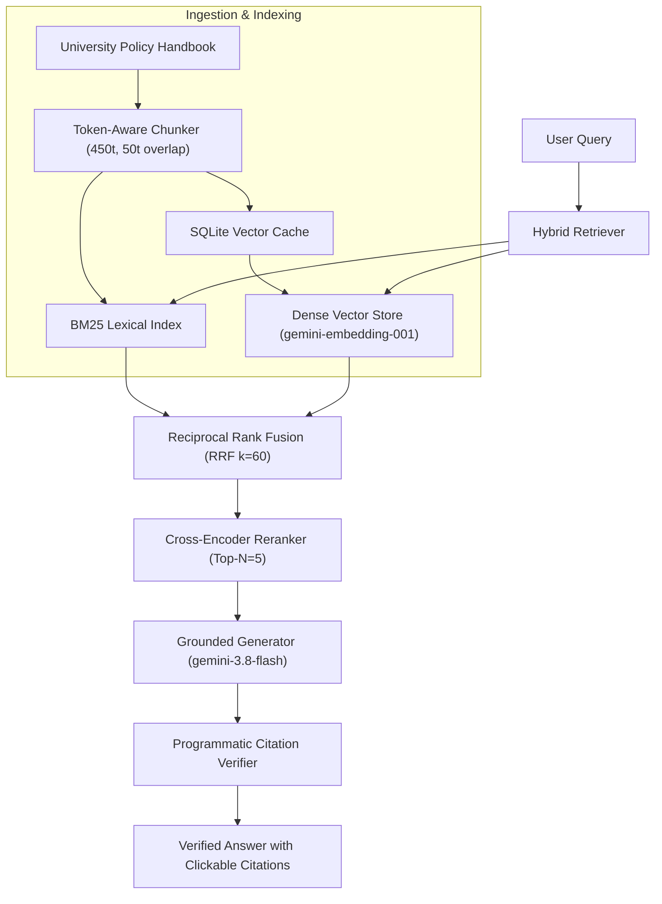

# RAG System Architecture & Design Specification

## System Overview

## Key Architectural Principles

1. **Strict Context Grounding**: The LLM system instruction enforces that answers must be derived solely from retrieved text, with an explicit string refusal if context is insufficient.
2. **Deterministic Citation Verification**: Regular expressions extract every `[chunk_id]` tag and verify against the retrieved chunk set, flagging ungrounded claims or hallucinated references.
3. **Hybrid RRF Fusion**: Combines exact lexical term matches (BM25) with semantic embeddings using `RRF = sum(1 / (k + rank))` with constant `k=60`.
4. **Persistent SQLite Caching**: Eliminates duplicate embedding calls to Google GenAI, enabling lightning-fast local re-indexing.
